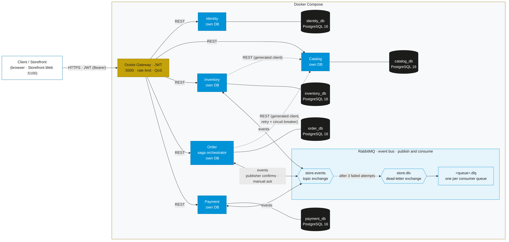
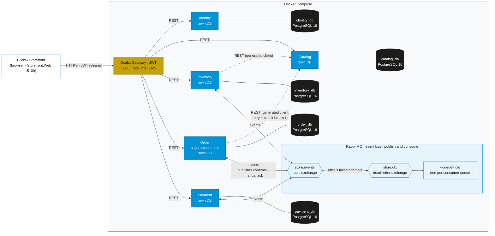
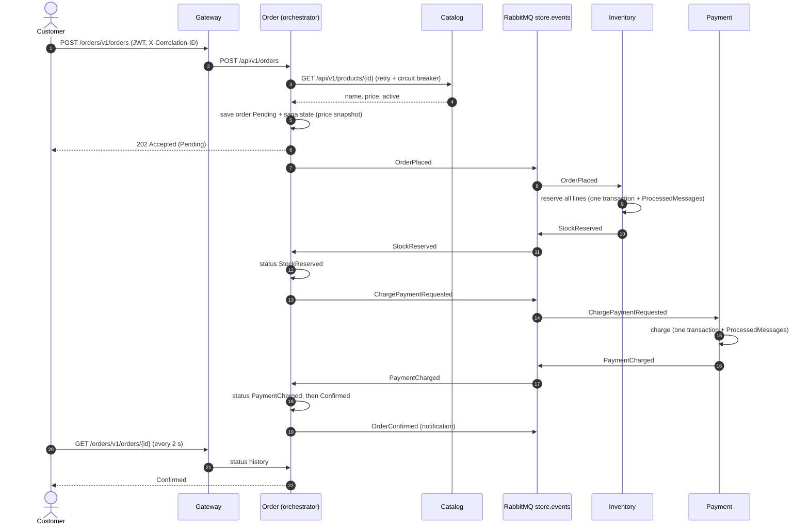
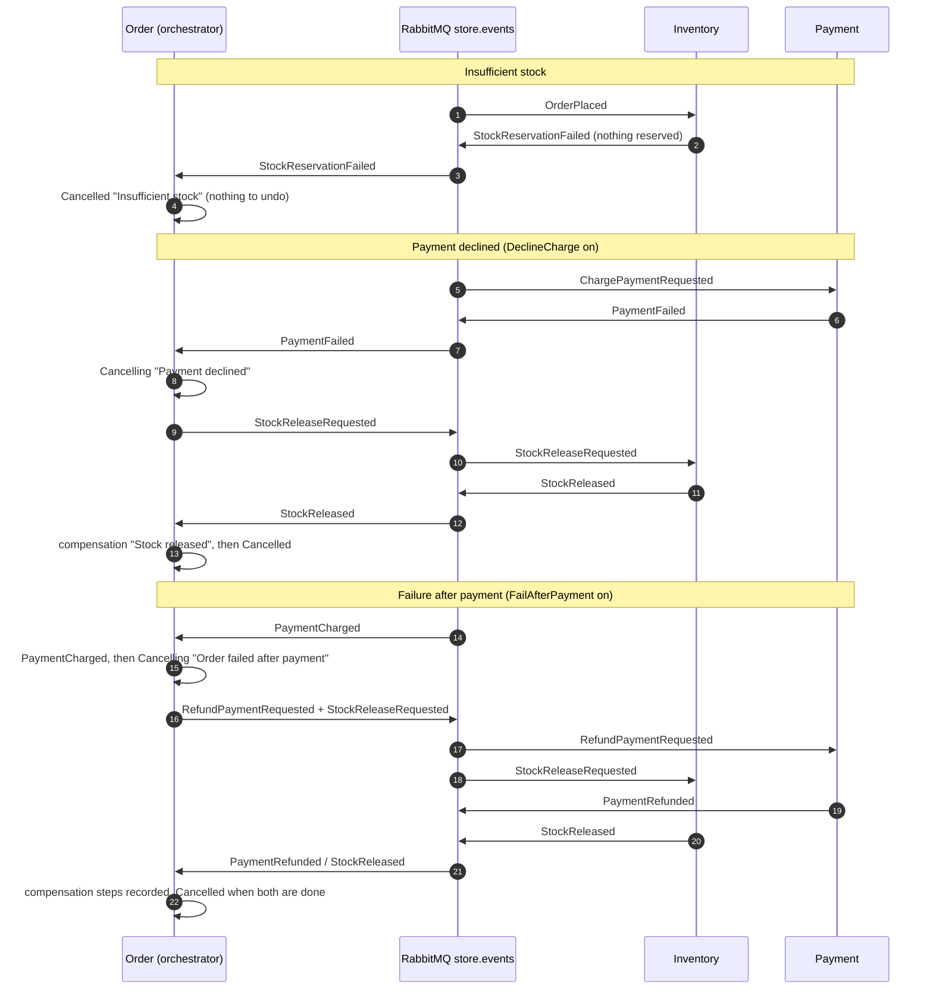

# Store Platform Capstone

**CruzDusty_StorePlatformCapstone**: a microservices campus store for UST Angelicum College. Five .NET 10 services, each with its own PostgreSQL 16 database, an Ocelot API gateway, RabbitMQ events with an orchestrated order saga, and an ASP.NET Core MVC Storefront, all started with one `docker compose up --build`.

UST Angelicum College · Capstone project



## Team

| Member | GitHub | Services | Shared pieces |
|---|---|---|---|
| Stefan Pimentel | [@PimentelStef](https://github.com/PimentelStef) | Catalog, Gateway, Docker Compose | Store.Observability |
| Erl Lorence Nievera | [@ErlNievera](https://github.com/ErlNievera) | Inventory, Payment | Store.Contracts.Events, Store.Messaging |
| Klarence Villar | [@KlarenceVillar](https://github.com/KlarenceVillar) | Identity, Order (saga), Storefront | |

## Contents

- [Prerequisites](#prerequisites)
- [Run it](#run-it)
- [Port map](#port-map)
- [Demo accounts](#demo-accounts)
- [What to try](#what-to-try)
- [Architecture](#architecture)
- [Eventual consistency](#eventual-consistency)
- [API contracts](#api-contracts)
- [Repository layout](#repository-layout)
- [Troubleshooting](#troubleshooting)
- [Technology notes](#technology-notes)
- [How we work](#how-we-work)

## Prerequisites

- **Docker Desktop** with Compose v2 (4 GB of memory for Docker is comfortable; 13 containers run at once).
- **.NET 10 SDK** (only to build or run outside Docker; `setup.cmd` uses it to build the solution once).
- **Git**.
- Free host ports 5000-5005, 5100 and 15672.
- Optional: Postman or newman, or VS Code with the REST Client extension, for the API flows.

## Run it

```
git clone https://github.com/ErlNievera/StorePlatformFinal.git
cd StorePlatformFinal
setup.cmd
docker compose up --build
```

1. `setup.cmd` checks Docker and .NET, creates `.env` from `.env.example` (local-development values only; `.env` is gitignored) and builds the solution.
2. `docker compose up --build` builds seven images and starts 13 containers. The first build downloads base images and NuGet packages and takes several minutes; later runs are fast.
3. Containers start in dependency order (databases and RabbitMQ, then services, then the gateway, then the Storefront). Wait until `docker compose ps` shows every container **healthy**.
4. Open the Storefront at **http://localhost:5100**, or call the API through the gateway at **http://localhost:5000**.

Each service migrates its own database and seeds data on first start (10 products with stock, the demo accounts, failure switches set to `None`).

Stop with `Ctrl+C` or `docker compose down`. `docker compose down -v` also deletes the databases, so the next start re-seeds from scratch.

**Logo:** copy the college logo to `src/Storefront/Storefront.Web/wwwroot/images/logo.png` (from `%USERPROFILE%\Downloads\logo.png`). Until it is there, the Storefront shows a gold "AC" monogram instead.

## Port map

| Component | URL | Notes |
|---|---|---|
| Storefront | http://localhost:5100 | Shopper and admin UI; calls only the gateway |
| Gateway (Ocelot) | http://localhost:5000 | The only API entry point: `/identity/v1`, `/catalog/v1`, `/inventory/v1`, `/orders/v1`, `/payments/v1` |
| Identity.Api Swagger | http://localhost:5001/swagger | Development only |
| Catalog.Api Swagger | http://localhost:5002/swagger | Development only |
| Inventory.Api Swagger | http://localhost:5003/swagger | Development only |
| Order.Api Swagger | http://localhost:5004/swagger | Development only |
| Payment.Api Swagger | http://localhost:5005/swagger | Development only |
| RabbitMQ management | http://localhost:15672 | `guest` / `guest` (from `.env`) |
| PostgreSQL × 5 | not published | Reachable only on the compose network |

## Demo accounts

Seeded by Identity.Api from `.env` (`SEED_*`):

| Role | Email | Password |
|---|---|---|
| Admin | `admin@store.local` | `Admin#Dev2026` |
| Customer | `customer@store.local` | `Customer#Dev2026` |

New customers can register in the Storefront. Product `ac000000-0000-4000-a000-000000000010` (Founders' Commemorative Medal) has 1 unit for the insufficient-stock demo.

## What to try

| Scenario | How | Result |
|---|---|---|
| Successful order | Storefront → sign in as customer → add to cart → checkout | Timeline: Pending → Stock reserved → Payment charged → Confirmed |
| Insufficient stock | Order 2 × Founders' Commemorative Medal | Cancelled "Insufficient stock", nothing charged |
| Payment declined | Admin → Chaos & Saga Testing → **Decline charges**, then order | Stock released (red), Cancelled |
| Failure after payment | Admin → **Fail after payment**, then order | Payment refunded and stock released (red), Cancelled |
| Retry | Admin → Catalog faults 50% → order | Order succeeds; `docker compose logs order-api` shows `Retrying Catalog call` |
| 401 / 403 | `http/flows.http` section 7, or the Postman folder "Security" | 401 without a token, 403 with a customer token on admin routes |
| Rate limit | Six wrong logins within a minute | `429 Too many login attempts. You can try again in a minute.` |

The same switches through the API (Admin token):

```
PUT http://localhost:5000/payments/v1/admin/failure-mode   { "mode": "None" | "DeclineCharge" }
PUT http://localhost:5000/orders/v1/admin/failure-mode     { "mode": "None" | "FailAfterPayment" }
PUT http://localhost:5000/catalog/v1/chaos                 { "failureRate": 0.5, "delayMs": 0 }
```

Every flow is scripted in [`postman/`](postman) (collection + environment; `npx newman run postman/StorePlatform.postman_collection.json -e postman/StorePlatform.postman_environment.json`) and [`http/flows.http`](http/flows.http).

## Architecture



| Component | Responsibility |
|---|---|
| Identity.Api | Register, login, issues JWTs (roles `Customer`, `Admin`) |
| Catalog.Api | Products (name, price, active flag); source of truth for what can be sold; dev-only chaos switch |
| Inventory.Api | Stock on hand and reservations per product |
| Order.Api | Orders, lines, status history; **orchestrates the saga** |
| Payment.Api | Charges and refunds; on-demand DeclineCharge switch |
| Gateway.Api | Ocelot: single entry point, JWT validation, Admin/Customer route claims, login rate limit, QoS, correlation id |
| Storefront.Web | MVC UI that calls only the gateway; JWT kept in an HttpOnly cookie |
| Store.Contracts.Events | Event records and routing keys |
| Store.Messaging | RabbitMQ connection, publisher confirms, consumer base with manual ack, DLX/DLQ, idempotency |
| Store.Observability | Correlation id, Problem Details, logging scopes, JWT validation, API versioning and Swagger |

### The order saga





More detail: [docs/architecture.md](docs/architecture.md) · [docs/messaging.md](docs/messaging.md) · [docs/observability.md](docs/observability.md) · [docs/security.md](docs/security.md).

## Eventual consistency

There is no distributed transaction. Each service commits only to its own database, and the services agree **eventually**, through events. What that means in practice:

- **Order status vs. stock vs. payment.** Right after `POST /orders`, the order is `Pending` while Inventory has not reserved anything and Payment has not charged anything. For a short window (normally well under a second) the three databases disagree. The saga moves them toward agreement one local transaction at a time: Inventory reserves, then Order records `StockReserved`; Payment charges, then Order records `PaymentCharged` and `Confirmed`.
- **Compensation instead of rollback.** If a later step fails, earlier steps are undone with new transactions, not rolled back: a decline makes Order request `StockReleaseRequested`; a failure after payment makes it request a refund and a release. During compensation the order is `Cancelling`, stock may still be reserved and money may still be charged; it becomes `Cancelled` only when every compensation has been confirmed. Each step and its reason is in the order's status history.
- **Price snapshot on order lines.** Order copies each product's name and price from Catalog into the order line when the order is placed. Payment charges that snapshot total. If an admin changes the price or deactivates the product afterwards, the existing order is unaffected; Catalog's current price only applies to new orders. The Storefront cart shows Catalog's current price until checkout.
- **Reads can be slightly behind.** The Storefront and API show each service's own data. Stock shown on a product page may change before checkout; that is why Inventory checks availability again when the order is placed, and an order can still end `Cancelled` for insufficient stock.
- **At-least-once delivery.** RabbitMQ may deliver a message more than once. Every consumer records `(MessageId, Consumer)` in a `ProcessedMessages` table in the same transaction as its change, so a duplicate changes nothing; outcome events derive their id from the handled message, so a re-sent outcome is also a duplicate downstream.
- **Lost messages are recovered, not ignored.** Publishes wait for broker confirms; a message that keeps failing goes to its `.dlq` instead of disappearing; and Order.Api's stalled-saga monitor republishes the current step's command for any saga that has waited more than 30 seconds (for example when RabbitMQ was briefly down right after an order was saved).
- **Confirmed orders keep their reservation.** Shipping is out of scope, so units of confirmed orders stay counted as reserved rather than being deducted from on-hand stock.

## API contracts

Every service is described by an OpenAPI 3.0 contract in `contracts/`, merged before its controllers were written. Controllers match the contracts (paths, operationIds, schemas, status codes), and every cross-service or Storefront call goes through a client generated from them.

| Contract | Gateway base URL | Service base URL (dev) |
|---|---|---|
| `contracts/identity.v1.yaml` | `http://localhost:5000/identity/v1` | `http://localhost:5001/api/v1` |
| `contracts/catalog.v1.yaml` | `http://localhost:5000/catalog/v1` | `http://localhost:5002/api/v1` |
| `contracts/inventory.v1.yaml` | `http://localhost:5000/inventory/v1` | `http://localhost:5003/api/v1` |
| `contracts/order.v1.yaml` | `http://localhost:5000/orders/v1` | `http://localhost:5004/api/v1` |
| `contracts/payment.v1.yaml` | `http://localhost:5000/payments/v1` | `http://localhost:5005/api/v1` |

Paths in each contract are relative to these base URLs, so a generated client switches between the gateway and a service by changing only its base address. Errors are `application/problem+json` with a `correlationId` extension.

## Repository layout

```
CruzDusty_StorePlatformCapstone.slnx   solution (all projects)
docker-compose.yml                     the whole system
.env.example                           local-dev configuration (copied to .env by setup.cmd)
setup.cmd                              one-time setup for Windows
contracts/                             OpenAPI 3.0 contracts, one per service
docs/                                  architecture, messaging, observability and security notes, diagrams
postman/                               Postman collection and environment
http/                                  flows.http for VS Code REST Client / Rider
Evidence/                              demo checklist and capture instructions
src/
  Gateway/Gateway.Api                  Ocelot gateway
  Services/Identity/Identity.Api
  Services/Catalog/Catalog.Api
  Services/Inventory/Inventory.Api
  Services/Order/Order.Api
  Services/Payment/Payment.Api
  Shared/Store.Contracts.Events
  Shared/Store.Messaging
  Shared/Store.Observability
  Storefront/Storefront.Web
```

## Troubleshooting

| Symptom | Fix |
|---|---|
| `setup.cmd` says Docker is not running | Start Docker Desktop and wait until it says "Engine running", then run `setup.cmd` again. |
| `port is already allocated` | Another program uses 5000-5005, 5100 or 15672. Stop it, or change the `*_PORT` values in `.env`. |
| A container stays `unhealthy` or `starting` | `docker compose ps` then `docker compose logs <service>`. Services wait for their database and RabbitMQ and retry; the first start can take a minute. |
| `NU1301` / restore errors during the build | The build needs internet access to nuget.org. Check your connection or proxy, then run `docker compose build --no-cache <service>`. |
| Login returns 429 | The gateway allows 5 login attempts per minute per client. Wait a minute. |
| Storefront says "Please sign in" after a restart | Sign in again; tokens last `JWT_EXPIRES_MINUTES` (60). |
| Orders stay `Pending` | RabbitMQ or Inventory is down. Check `docker compose ps`; once it is back, the stalled-saga monitor republishes within about 30 seconds. |
| Every order is cancelled | A failure switch or chaos is still on. Admin → Chaos & Saga Testing → set both modes to normal and Catalog faults to 0. |
| Orders fail with 503 "Catalog is unavailable" | Catalog chaos is high or Catalog is down; the circuit breaker opens for 15 s. Turn chaos off and retry. |
| Start completely fresh | `docker compose down -v` (deletes all data), then `docker compose up --build`. |
| No logo in the navbar | Copy `logo.png` into `src/Storefront/Storefront.Web/wwwroot/images/` and rebuild the Storefront (`docker compose up --build storefront`). |
| Follow one request across services | `docker compose logs --no-log-prefix | findstr "CorrelationId:<id>"` (Windows) or `grep` elsewhere; the id is in every response's `X-Correlation-ID` header. |

## Technology notes

- **.NET 10** for every project (`global.json` pins the 10.0.100 SDK band with roll-forward).
- **Ocelot 24.1.0** with **Ocelot.Provider.Polly 24.1.0** in the gateway. The newest Ocelot (25.x) supports .NET 10, but the newest Polly provider is built for Ocelot 24.1 and does not attach to Ocelot 25, which silently disabled QoS. Ocelot 24.1.0 runs on .NET 10, so every project stays on .NET 10.
- Asp.Versioning 10 (URL segment), Swashbuckle 10 (Swagger per version), NSwag 14 (`OpenApiReference` generated clients), Microsoft.Extensions.Http.Resilience 10, RabbitMQ.Client 7 (async API, publisher confirms), EF Core 10 + Npgsql (migrations committed, auto-migrate and seed at startup with retry), ASP.NET Core Identity.
- Storefront: Bootstrap 5.3, Bootstrap Icons and Google Fonts (Cinzel, Inter) from CDNs.

## How we work

- `main` is protected; all work goes through pull requests reviewed by a teammate.
- Branch names: `<github-username>/phase<N>-<short-topic>`, for example `PimentelStef/phase1-catalog-contract`.
- Conventional commit messages: `feat(catalog): ...`, `fix(saga): ...`, `docs(readme): ...`, `chore(compose): ...`, `test(postman): ...`.
- Contract-first: each service's OpenAPI contract merged before any controller for that service was written.
- `dotnet build CruzDusty_StorePlatformCapstone.slnx` must pass before every push; Docker changes are checked with `docker compose config`.

Review rotation:

| PR author | Reviewer |
|---|---|
| Stefan Pimentel | @KlarenceVillar |
| Erl Lorence Nievera | @PimentelStef |
| Klarence Villar | @ErlNievera |
