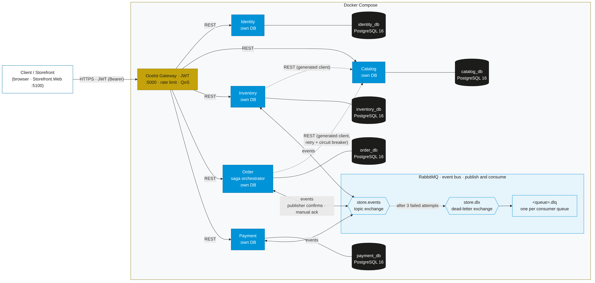
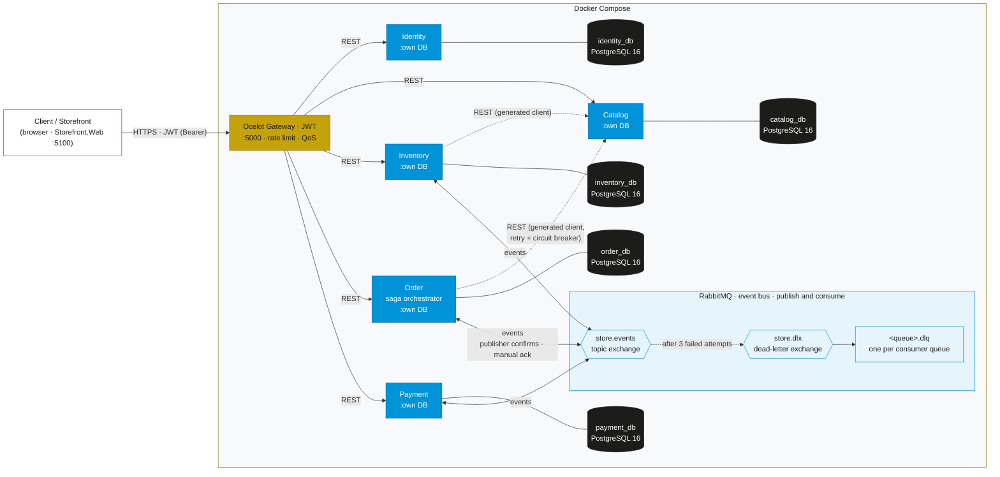
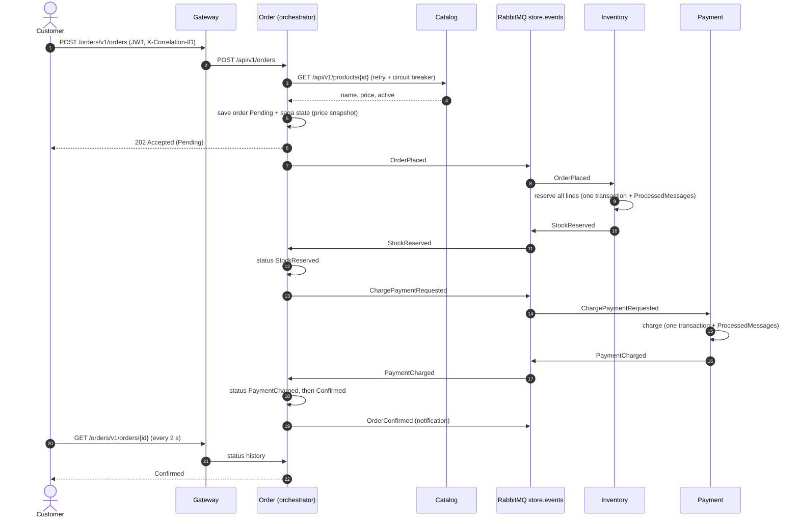
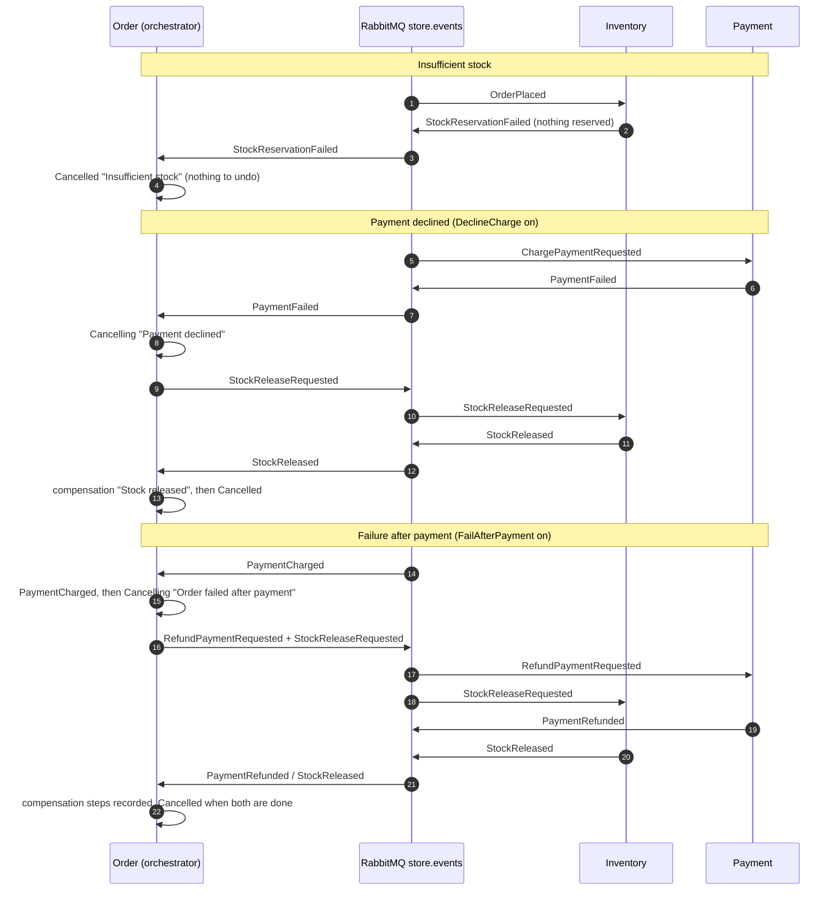

# Architecture

Store Platform is a set of independently deployable .NET 10 services behind an Ocelot API gateway. Each service owns its PostgreSQL 16 database; services talk synchronously over REST (through clients generated from the OpenAPI contracts) and asynchronously through RabbitMQ events. The order flow is an **orchestrated saga** run by Order.Api.



The diagram source is [`architecture.mmd`](architecture.mmd) (Mermaid). Regenerate the PNG with:

```bash
npx -y @mermaid-js/mermaid-cli -i docs/architecture.mmd -o docs/architecture.png -b white -w 2200 -s 2
```



## Components

| Component | Port (host) | Responsibility | Talks to |
|---|---|---|---|
| Gateway.Api (Ocelot) | 5000 | Single entry point; validates JWTs, enforces `Admin`/`Customer` route claims, rate-limits login, QoS on Catalog, creates `X-Correlation-ID` | every service |
| Storefront.Web (MVC) | 5100 | Shopper and admin UI; keeps the JWT in an HttpOnly cookie | gateway only (generated clients) |
| Identity.Api | 5001 (dev) | Register, login, JWT issuing (roles `Customer`, `Admin`) | identity_db |
| Catalog.Api | 5002 (dev) | Products, price, active flag; dev-only chaos switch | catalog_db |
| Inventory.Api | 5003 (dev) | Stock on hand and reservations; reserve/release in the saga | inventory_db, Catalog (validate products), RabbitMQ |
| Order.Api | 5004 (dev) | Orders, lines, status history; **saga orchestrator**; FailAfterPayment switch | order_db, Catalog (price/active), RabbitMQ |
| Payment.Api | 5005 (dev) | Charges and refunds; DeclineCharge switch | payment_db, RabbitMQ |
| RabbitMQ | 15672 (UI) | `store.events` topic exchange, `store.dlx` dead-letter exchange, one durable queue + `.dlq` per consumer | |
| PostgreSQL 16 × 5 | not published | Database per service | |

Shared libraries: `Store.Contracts.Events` (event records and routing keys), `Store.Messaging` (connection, publisher confirms, consumer base with manual ack, DLX/DLQ topology, ProcessedMessages idempotency) and `Store.Observability` (correlation id, Problem Details, logging scopes, JWT validation, API versioning and Swagger).

## Synchronous calls

- Clients and the Storefront call `http://localhost:5000/<service>/v1/<resource>`; Ocelot forwards to `/api/v1/<resource>` on the service (URL-segment API versioning).
- Order → Catalog (price and active state at placement) and Inventory → Catalog (validate a new product) use NSwag clients generated from `contracts/catalog.v1.yaml`, registered with `AddStandardResilienceHandler`: 3 retries with exponential backoff and jitter, 2 s attempt timeout, 10 s total, circuit breaker. An adapter turns 404 into "not found" and every other failure into `DownstreamServiceException` → 503 Problem Details.

## The order saga

Order.Api orchestrates every step. Each step is **one local transaction** in the service that performs it (business change + `ProcessedMessages` row), followed by a confirmed publish. Commands and replies keep the correlation id of the original request.

### Happy path



### Compensation paths



| Path | Order history |
|---|---|
| Success | Pending → StockReserved → PaymentCharged → Confirmed |
| Insufficient stock | Pending → Cancelled ("Insufficient stock: requested 2, available 1") |
| Payment declined | Pending → StockReserved → Cancelling ("Payment declined …") → *Stock released* → Cancelled |
| Failure after payment | Pending → StockReserved → PaymentCharged → Cancelling ("Order failed after payment …") → *Payment refunded* → *Stock released* → Cancelled |

Italic entries are compensation steps (`isCompensation: true`), drawn in red on the Storefront timeline.

### Reliability

- **Publisher confirms** on every publish; saga commands are `mandatory`, so an unroutable message fails loudly. `OrderConfirmed`/`OrderCancelled` are notifications and need no subscriber.
- **Manual ack** after the database commit; failures are retried and, after 3 attempts, dead-lettered to `<queue>.dlq` (see [messaging.md](messaging.md)).
- **Idempotency**: `ProcessedMessages (MessageId, Consumer)` in each consuming service; outcome events derive their `MessageId` from the handled message, so a republished outcome is deduplicated downstream.
- **Stalled-saga monitor** in Order.Api republishes the current step's command for sagas idle more than 30 s (for example when RabbitMQ was briefly unavailable after an order was saved).

## Cross-cutting

- Correlation and resilience evidence: [observability.md](observability.md)
- Gateway and service authorization, 401/403 matrix: [security.md](security.md)
- Queues, DLQs and how to force a dead-letter: [messaging.md](messaging.md)
